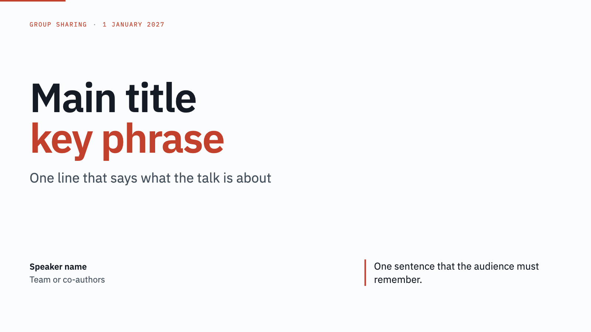
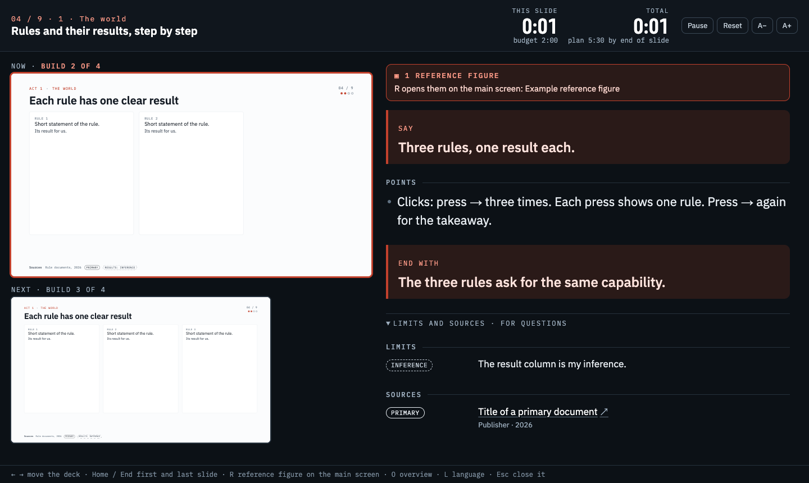

# html-presentation-deck

A Claude Code skill that turns research material you already have (reports, interactive HTML pages, charts, data)
into a talk delivered as an interactive HTML presentation.



**Tired of agent-made slides that scream "AI" — bullet soup, random gradients, text spilling off the edge?**
**Want a live map, a simulator or a draggable chart in your talk, and PowerPoint just says no?**
**Spent the night before the talk fixing one word in 30 slides?**

This skill builds the deck the way a careful analyst would: from **your** material, one finding per slide,
a quiet house style, sources and evidence tags on every page. It stops and asks you at each step instead of
guessing. Your existing interactive HTML pages go straight onto the slides, live. And you present it like
PowerPoint — full screen on the projector, presenter view on your laptop — from **one offline file**.

> Real material in. A talk you are not embarrassed to give out.

## Install: send this to your agent

Paste this message to Claude Code (or Codex, or any agent that reads skills):

```text
Install the skill from https://github.com/GenLI3202/html-presentation-deck : clone it into ~/.claude/skills/html-presentation-deck (for Codex also link it into ~/.agents/skills/html-presentation-deck), then tell me to restart the session. If the folder exists, run git pull in it instead.
```

Or install it yourself:

```bash
git clone https://github.com/GenLI3202/html-presentation-deck ~/.claude/skills/html-presentation-deck
```

Restart the session. Then ask, for example: "Use html-presentation-deck to make a 20-minute talk from the reports
in ./research", or type `/html-presentation-deck`. Update later with `git -C ~/.claude/skills/html-presentation-deck pull`.

**Needs:** Python 3, Google Chrome, and Node.js for the checks and the PDF (the skill installs `puppeteer-core` in
a scratch folder when it needs it). The first build downloads the fonts once.

## What you get

- A single offline `preview.html`: 1920×1080 stage, double-click to play, no server, no network.
- Notes and sources panel (N), presenter window for the speaker's laptop (P), reference figures (R), full screen (F).
- Calm motion matched to the content: morph, push, fade, gentle zoom, spotlight, progress strip, builds, zoom details.
- Edit the wording in the page (E) and merge the edits back into the sources.
- Optional language switch (L), for example English and Chinese, without edit conflicts.
- Optional: a claude.ai Artifact, a PDF handout (interactive slides storyboarded into pages), an A4 speaker script.

The skill works with you at fixed gates: materials, storyline, slide text (ASD-STE100 English by default), motion,
deliverables and PDF contents. It does not add pages or extras without asking.

## Present like PowerPoint: a presenter view on a second screen

Press **F** for full screen on the projector, then **P** to open the presenter window on your laptop, like the
presenter view in PowerPoint or Keynote. The two windows stay in sync, and ← → in either window drives the deck.



- **Notes:** Say, Points (with click cues) and End with, in large type (A− / A+); limits and sources folded, for questions.
- **Now and next:** the current slide with its build step ("build 2 of 4") and a preview of the next step or slide.
- **Timers:** this slide against its time budget, and the whole talk against the plan; amber near the limit, red over it.
- Works from the offline file and on a claude.ai Artifact. If the browser blocks pop-ups, N shows the notes in the same window.

## Try it

Open `assets/gallery/preview.html` in a browser and press →: seven content situations, each with the transition
that fits it (fake content).

## Layout

- `SKILL.md`: the workflow and the gates.
- `references/`: workflow, writing rules, deck anatomy, embeds, notes and figures, motion, delivery, languages,
  PDF storyboard, pitfalls.
- `assets/template/`: the engine and starter slides; `scripts/init_deck.py` copies it into a new deck.
- `scripts/check_deck.cjs`: overflow, overlap, errors, network and contact-sheet check.
- `assets/gallery/`: the motion gallery deck.

---

## 中文说明

把已有的研究成果（报告、交互网页、图表、数据）汇编成一场 HTML 演讲的 Claude Code skill。

**安装：把下面这段话发给你的 agent（Claude Code、Codex 等）：**

```text
请安装 skill：https://github.com/GenLI3202/html-presentation-deck 。把它 clone 到 ~/.claude/skills/html-presentation-deck（Codex 用户再链接到 ~/.agents/skills/html-presentation-deck），完成后提醒我重启会话。如果目录已存在，就在里面执行 git pull 更新。
```

重启会话后，说“用 html-presentation-deck 把 ./research 里的报告做成一个 20 分钟的演讲”，或输入 `/html-presentation-deck`。


**受够了 agent 做出来 AI 味十足、排版凌乱、字都溢出边框的 PPT？**
**想在演讲里放一张能点的地图、一个能拖的仿真图，PPT 却根本不支持？**
**演讲前一晚还在 30 页里来回改一个词？**

这个 skill 像一位细心的分析师那样做演讲：只用**你自己的**素材，一页一个结论，克制统一的版式，每页都有来源和证据标签；每一步都先停下来问你，不瞎猜。你已有的交互网页直接嵌进幻灯片，现场就能点、能拖。演讲时像 PPT 一样：投影屏全屏，笔记本上看演讲者视图——全部只靠**一个离线文件**。

> 素材进去，出来的是一场你敢站上台讲的演讲。

**像 PPT 一样演示（演讲者视图）：** 投影屏按 **F** 全屏，再按 **P**，在自己的笔记本上打开演讲者窗口。两个窗口同步翻页，在哪个窗口按 ← → 都行。窗口里有大字讲稿（开场、要点含点击提示、收尾，字号可调）、当前页和下一步预览、本页与全场计时（接近超时变黄、超时变红），以及折叠的局限与来源，供答问时用。


**功能：** 离线单文件播放；备注与来源（N）；演讲者窗口（P）；参考图（R）；按内容选择的平静动效；页面内改字（E）并写回源文件；中英一键切换（L）；可选发布 Artifact、PDF 讲义和 A4 讲稿。skill 会在素材、故事线、文字、动效、交付物、PDF 内容几个节点停下来和你确认。

**试看：** 用浏览器打开 `assets/gallery/preview.html`，按 → 浏览七种场景与对应动效。
